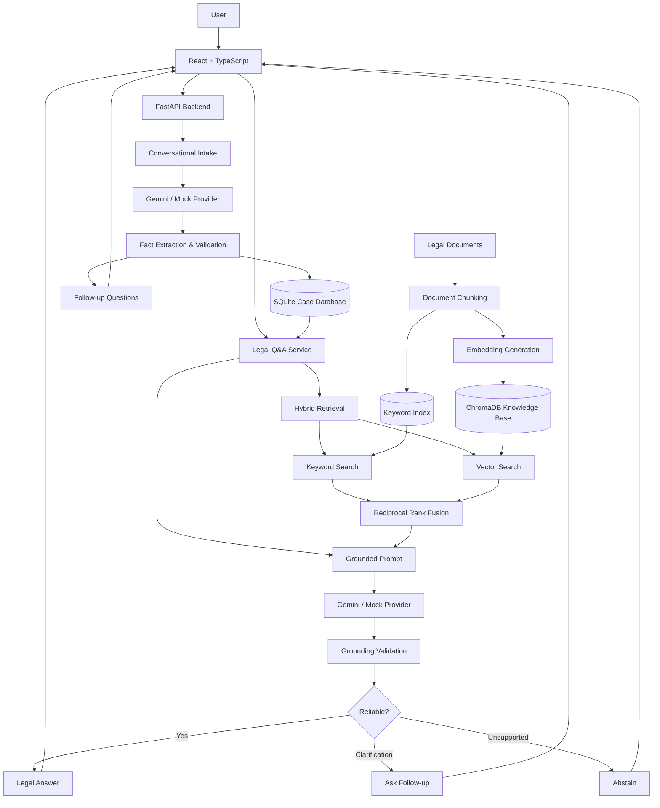

# AI Lawyer

Solution Document | Uttarakhand, India | Residential Tenancy and Security-Deposit Disputes

## 1. Introduction and Problem Scope

AI Lawyer is a conversational legal assistant focused on helping tenants in Uttarakhand understand residential rental security-deposit disputes.

The prototype focuses on the Uttarakhand Tenancy Act, 2021 (Uttarakhand Act No. 02 of 2022) and a curated legal knowledge base containing relevant provisions, applicability conditions, qualifications, source references and unresolved legal questions.

Rather than attempting to cover all Indian law, the project concentrates on one specific problem: helping tenants understand their position when a landlord withholds a residential security deposit.

The system does not automatically assume that the Act applies to every tenancy in Uttarakhand. Applicability depends on relevant facts and statutory conditions.

## 2. Key Features

1\. Conversational Case Intake: Users describe their dispute naturally. The system extracts details such as rent, deposit, agreement terms, dates and evidence, and asks follow-up questions for missing information.

2\. Structured Case Management: Cases and conversations are persisted in SQLite. Fact provenance distinguishes user-confirmed information from model-extracted facts, while conflicting details are flagged for confirmation.

3\. Retrieval-Grounded Legal Q&A: Retrieves relevant Uttarakhand tenancy provisions using hybrid search and generates structured answers with legal reasoning, qualifications and recommended next steps.

4\. Legal Grounding and Abstention: Enforces Uttarakhand jurisdiction server-side, validates citations and flags unsupported legal claims. The system can ask for clarification or abstain when information is insufficient.

5\. LLM Provider Abstraction: Supports Gemini and a mock provider through a common interface, allowing model replacement and deterministic testing.

6\. Document Preparation (Partial): Backend support for legal notice requirements, applicability checks and draft persistence exists, but the complete user-facing generation workflow is not yet reliable.

## 3. System Architecture

The React frontend communicates with a FastAPI modular backend. SQLite stores case information, while ChromaDB stores the indexed legal knowledge base.

## 4. Working Approach

The system combines deterministic backend logic with LLM-based natural-language processing.

1. Intake: Users describe their dispute conversationally. Gemini extracts structured facts and generates follow-up questions.
2. Fact Management: Backend logic validates updates, detects conflicts, tracks fact provenance and persists information in SQLite.
3. Legal Retrieval: The user's question is searched against the Uttarakhand legal knowledge base using keyword and vector retrieval.
4. Answer Generation: Retrieved provisions, qualifications, case facts and the user's question are passed to Gemini.
5. Grounding Validation: Backend checks verify citations and flag unsupported legal claims. The system returns an answer, requests clarification or abstains.

Code vs. LLM: Code handles persistence, fact-update rules, jurisdiction enforcement, retrieval, validation and workflow decisions. The LLM handles natural-language understanding, fact extraction, follow-up questions and legal explanations. Legal interpretation remains partly model-dependent.

## 5. RAG Implementation

The retrieval-augmented generation pipeline grounds legal answers in a curated knowledge base instead of relying entirely on the LLM's pretrained knowledge.

### Knowledge Ingestion and Indexing

- Legal material is maintained in curated Markdown files covering provisions, applicability, qualifications and source references.
- A custom Markdown parser extracts structured provision information.
- Provisions are validated before indexing to exclude incomplete, unverified or unsupported records.
- Each valid provision is indexed as a separate chunk in ChromaDB.
- MiniLM-L6-v2 generates 384-dimensional embeddings for semantic retrieval.

### Hybrid Retrieval

The system combines two independent retrieval methods:

- Keyword Search: Searches provision identifiers, sections, legal propositions and qualifications.
- Vector Search: Uses query embeddings to retrieve semantically similar provisions from ChromaDB.
- Reciprocal Rank Fusion: Combines the two rankings using:

\\[ RRF(d)=\frac{1}{k+rank(d)} \\]

The implementation uses \\(k=60\\), deduplicates results and produces a combined ranking.

### Grounded Answer Generation

The top retrieved provisions, including their qualifications, are passed to Gemini along with the user's question and case facts.

Gemini generates a structured legal response containing the legal position, applicable provisions, reasoning, limitations and recommended next steps.

A deterministic validation layer checks whether cited provisions exist in the retrieved context and flags unsupported statutory references, deadlines and material claims. Where grounding is insufficient, the system can clarify or abstain.

Implementation stack:

| Component         | Technology                      |
| ----------------- | ------------------------------- |
| Knowledge parsing | Custom Markdown parser          |
| Embeddings        | MiniLM-L6-v2                    |
| Vector database   | ChromaDB                        |
| Keyword retrieval | Custom provision-level search   |
| Hybrid ranking    | Reciprocal Rank Fusion          |
| LLM               | Gemini 3.1 Flash Lite           |
| Validation        | Pydantic + deterministic checks |

## 6. Evaluation and Quality Checks

Evaluation focused on retrieval relevance, jurisdiction correctness, backend reliability and grounded answer generation.

| Metric                                           | Result |
| ------------------------------------------------ | ------ |
| Authored retrieval test cases                    | 15     |
| Quantitatively testable cases                    | 7      |
| Recall\@5                                        | 0.71   |
| Precision\@5                                     | 0.57   |
| MRR                                              | 0.65   |
| Cases retrieving at least one relevant provision | 6/7    |
| Correct jurisdiction filtering                   | 7/7    |

Additional testing:

- Legal-answer tests: 14/14 passed.
- Backend regression tests: 56/56 passed in the reported test run.
- Grounding checks: Tested rejection of citations absent from retrieved context and handling of unsupported legal claims.

Only seven of the fifteen retrieval cases were sufficiently annotated for quantitative evaluation. These results demonstrate behaviour on the tested set, not legal correctness across all possible disputes.

## 7. Limitations and Known Failures

- Limited legal coverage: The system focuses on Uttarakhand residential security-deposit disputes. Other jurisdictions and legal domains are outside its verified scope.
- Unresolved applicability: Rent Authority operational status and statutory exemptions remain unresolved. The system therefore cannot make definitive claims about applicable forums or procedures.
- Legal interpretation risk: Testing identified confusion between Section 11 subsections and an unsupported reference to a reasonable refund period. Citation membership checks alone cannot guarantee correct legal interpretation.
- Incomplete document generation: Backend support for legal notice requirements and draft persistence exists, but the complete user-facing generation workflow is not reliable.
- Unsupported capabilities: PDF/DOCX export, email dispatch, voice interaction, case filing and support for other jurisdictions are not implemented.

## 8. Scalability and Future Scope

The modular architecture can be extended by adding separately reviewed and versioned legal knowledge bases for additional jurisdictions, along with jurisdiction-specific applicability rules and evaluation datasets.

For larger usage, SQLite can be replaced with PostgreSQL, case files can move to object storage, and the API can run across multiple instances. Retrieval and embedding infrastructure can also be scaled independently.

These are proposed extensions, not capabilities currently benchmarked.

Human review: AI Lawyer provides preliminary legal information, not a lawyer's opinion. Unresolved applicability, high-stakes disputes or questions outside the verified scope should be referred to a qualified legal professional.

## 9. Technology Stack and Tools

- Frontend: React, TypeScript
- Backend: Python, FastAPI
- Database: SQLite, SQLAlchemy
- RAG: ChromaDB, MiniLM-L6-v2, custom keyword retrieval, RRF
- LLM: Gemini 3.1 Flash Lite, MockProvider
- Development tools: ChatGPT, Cline and Gemini

Note: Before submission, include the repository/prototype URL, setup instructions and raw test conversations or outputs as separate deliverables.